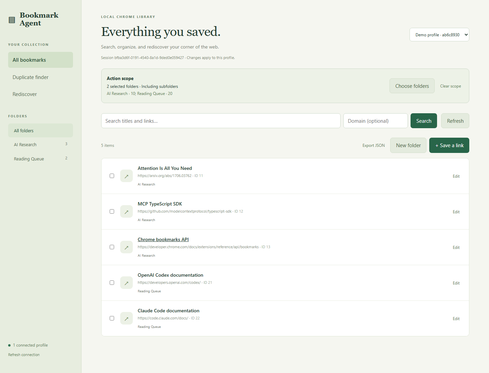
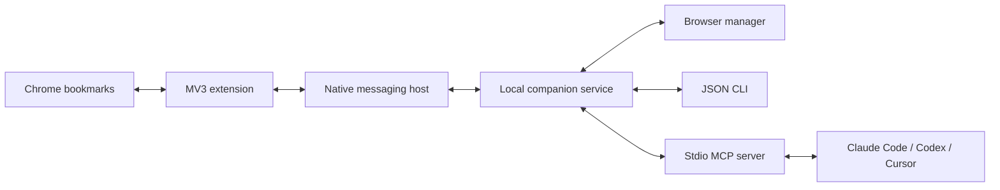

# Bookmark Agent

**Give your coding agents access to your Chrome bookmarks.** Search saved research, read folder contents, save useful links, and organize your library from Claude Code, Codex, Cursor, or another local agent.

Bookmark Agent is a **Chrome Manifest V3 extension with a local companion service**, a browser-based bookmark manager, a JSON CLI, and a **Model Context Protocol (MCP) server**. The extension reads and changes actual Chrome bookmarks through `chrome.bookmarks`. CLI and MCP expose those capabilities to agents running on your computer.

No cloud service or model subscription is required by Bookmark Agent itself. Your coding agent supplies the reasoning; Bookmark Agent supplies access to the library.



*The manager with synthetic demonstration bookmarks; no private library data is shown.*

## Capabilities

| Capability | What you can do |
| --- | --- |
| Read | Inspect the full tree, a subtree, an individual bookmark, or a folder's immediate children. |
| Search | Search titles and URLs; filter by domain, folder, or several folders; paginate results. |
| Write | Create bookmarks and folders, edit titles and URLs, move items, and delete bookmarks or folders. |
| Folder scope | Restrict reads, searches, exports, and writes to selected existing folders. Include subfolders by default or use direct children only. |
| Duplicate discovery | Group duplicate URLs for review before deciding what to keep. |
| Rediscovery | Surface least recently used links, falling back to oldest added when usage information is unavailable. |
| Export | Produce a JSON snapshot of the entire profile or selected folders. |
| Review and backup | Preview individual or batch changes, explicitly confirm the plan, and save a full backup before execution. |
| Multiple profiles | Connect enabled Chrome profiles independently and select by a friendly label. |

**No session UUID copying:** CLI and MCP use the sole connected Chrome profile automatically. With several profiles connected, select one by label, such as `--profile "Work Chrome"`. Explicit session selection remains available.

## Examples inside Claude Code

After installing the extension, starting the service, and registering MCP, ask Claude in ordinary language. These requests also work with Codex, Cursor, and other local agents that support MCP or shell commands.

### Read and search saved research

> Use Bookmark Agent to find my saved arXiv links about transformers. Show each title, URL, and folder. Read bookmarks only.

Claude can use `bookmark_search` with a text query and domain filter, then inspect the relevant folders with `bookmark_tree` or `bookmark_children`. This searches **your saved bookmarks**, not the public web.

### Save a link

> Find my existing “AI Research” bookmark folder. Prepare a bookmark titled “Attention Is All You Need” for https://arxiv.org/abs/1706.03762 in that folder. Show me the preview and wait for approval before applying it.

Claude resolves the folder ID, calls `bookmark_preview` with a `create` action, and shows the plan. After you approve, it calls `bookmark_commit`. Folder creation, title edits, URL edits, and moves follow the same flow.

### Organize within selected folders

> Work only inside my “AI Research” and “Reading Queue” folders, including their subfolders. Find saved GitHub repositories and propose moving relevant entries into an existing folder inside that scope. Show me the plan before changing anything.

Claude resolves the real folder IDs and supplies the same `scope` to its reads and preview. Bookmark Agent rejects targets and destinations outside the scope. Commit retains the preview's scope.

### Review duplicates

> Find duplicate URLs within “Reading Queue”. Show the duplicates and their folder locations. Propose which entries to keep, but do not delete anything until I approve the preview.

Duplicate discovery is a read operation. Proposed removals require preview and confirmation.

### Use the CLI from Claude's shell

> Run `bookmark-agent search github --limit 20` and summarize the results. Do not modify any bookmarks.

In PowerShell, use `bookmark-agent.cmd`. MCP provides tool discovery and structured arguments; the CLI supports shell workflows and scripts. The agent handles bookmark IDs and preview IDs for you.

## MCP tools

The stdio MCP server exposes ten tools:

| Tool | Purpose |
| --- | --- |
| `bookmark_status` | List connected Chrome profiles and connection status. |
| `bookmark_tree` | Read the library tree or a subtree. |
| `bookmark_get` | Read a bookmark or folder by ID. |
| `bookmark_children` | List a folder's immediate children. |
| `bookmark_search` | Search titles and URLs with domain, folder, scope, and pagination options. |
| `bookmark_duplicates` | Find duplicate URL groups without deleting anything. |
| `bookmark_rediscover` | Find least recently used or oldest added bookmarks. |
| `bookmark_export` | Return a JSON snapshot for the profile or selected scope. |
| `bookmark_preview` | Validate and preview up to 100 create, folder, update, move, or remove actions. |
| `bookmark_commit` | Apply an approved preview, saving a backup first. Requires `confirm: true`. |

Bookmark operations accept optional `profile`, `sessionId`, and `scope` selectors. Omit profile/session selectors when only one profile is connected. `bookmark_status` takes no arguments.

Example `bookmark_search` arguments:

```json
{
  "query": "transformer",
  "domain": "arxiv.org",
  "limit": 20,
  "scope": {"folderIds": ["10", "20"], "includeDescendants": true}
}
```

Folder IDs are illustrative. Ask the agent to resolve folder names to real IDs and disambiguate duplicate names by their full paths.

## Install on Windows

Requirements: **Windows, Chrome 120+, Node.js 22.12+, npm**, and the Windows .NET Framework C# compiler used by the native launcher. The provided activation workflow supports Windows; macOS/Linux activation has not been implemented or validated.

### 1. Clone and build

Run in PowerShell:

```powershell
git clone https://github.com/OWNER/chrome-bookmark-agent.git
cd chrome-bookmark-agent
npm.cmd run prepare:app
npm.cmd run build
npm.cmd test
npm.cmd run init-local
npm.cmd run setup -- --activate
```

Replace `OWNER` with the repository owner shown on GitHub. Setup registers a native messaging host for the current Windows user. Credentials and backups stay in `next/.runtime/`, excluded from Git. No administrator account is required. See [detailed setup and troubleshooting](next/docs/setup.md).

### 2. Start the service and enable the extension

```powershell
npm.cmd start
```

Keep this service running. In the intended Chrome profile:

1. Open `chrome://extensions` and enable **Developer mode**.
2. Click **Load unpacked** and select the repository's `next/dist/extension` folder.
3. Open Bookmark Agent settings, choose a recognizable profile label, check **Enable local bookmark access**, and save.
4. Open **Bookmark manager** from settings, or visit [http://127.0.0.1:32180/](http://127.0.0.1:32180/).

The manager connects without token entry. This is a source installation; no Chrome Web Store package is provided. Each extension installation can access only its own Chrome profile.

### 3. Install the CLI

From the repository root:

```powershell
npm.cmd link
bookmark-agent.cmd status
bookmark-agent.cmd search github --limit 20
```

In Git Bash, use `bookmark-agent`. If an existing terminal cannot find it, restart the terminal or use the repository wrapper: `./bookmark-agent` in Git Bash or `.\bookmark-agent.cmd` in PowerShell. Credentials load automatically from the application directory.

### 4. Connect a coding agent

From the repository root in PowerShell:

```powershell
$node = (Get-Command node.exe).Source
$mcp = (Resolve-Path .\next\dist\mcp.js).Path
```

**Claude Code**, available across projects:

```powershell
claude mcp add --transport stdio --scope user bookmark-agent -- $node $mcp
```

**Codex**:

```powershell
codex.cmd mcp add bookmark-agent -- $node $mcp
```

**Cursor**: add this to your MCP configuration, replacing the paths with your Node executable and checkout location:

```json
{
  "mcpServers": {
    "bookmark-agent": {
      "command": "C:/path/to/node.exe",
      "args": ["C:/path/to/chrome-bookmark-agent/next/dist/mcp.js"]
    }
  }
}
```

Other MCP clients can launch the same executable and script using **stdio transport**. The companion HTTP service is not an MCP HTTP endpoint. Restart agent sessions or reconnect MCP after registration or a schema update. Chrome, the enabled extension, and the companion service must remain running.

Test from the agent:

> Use Bookmark Agent. Check the connection, then search my saved bookmarks for “github”. Return matching titles and URLs. Do not change anything.

## CLI examples

```bash
bookmark-agent status
bookmark-agent tree
bookmark-agent children 10
bookmark-agent search transformer --domain arxiv.org --limit 20
bookmark-agent search github --scope 10 --scope 20
bookmark-agent children 10 --scope 10 --direct-only
bookmark-agent duplicates --scope 10
bookmark-agent rediscover --limit 10
bookmark-agent export --output ./bookmarks-export.json --scope 10
bookmark-agent search github --profile "Work Chrome"
```

Prepare a write, review its returned preview, then confirm it separately:

```bash
bookmark-agent create --parent 10 --title "Attention Is All You Need" --url https://arxiv.org/abs/1706.03762 --scope 10
bookmark-agent update 123 --title "Revised title" --scope 10
bookmark-agent move 123 --parent 20 --scope 10 --scope 20
bookmark-agent remove 123 --scope 10
bookmark-agent commit PREVIEW_UUID --confirm
```

Each change command produces its own preview; commit only the plan you have reviewed. IDs and `PREVIEW_UUID` are placeholders. Inside a coding agent, the agent handles these identifiers for you.

Output is JSON except help. Exit codes: `0` success, `1` service/operation failure, `2` invalid command. Export refuses to overwrite a file. See [complete CLI, HTTP, scope, and MCP usage](next/docs/usage.md).

## Architecture



The companion service binds to loopback. Agents authenticate using local configuration; the manager uses an automatically established same-origin session. Bookmark Agent itself does not send your library to a cloud service. An external coding agent may send tool results to its model provider according to that agent's configuration.

## Change controls and limits

- Writes require preview and separate confirmation. Previews expire after five minutes, are single-use, and are bound to their original Chrome session.
- A full-profile backup is saved before writes. Bookmark changes invalidate stale previews, including unrelated changes.
- Scope restricts targets and destinations. Selected scope folders cannot themselves be renamed, moved, or deleted. Scope is an operation boundary, not a separately restricted credential.
- Managed bookmarks remain read-only. Recursive deletion must be explicitly requested.
- Chrome batches are not atomic and can stop partway. Never automatically retry `OUTCOME_UNKNOWN`.
- Backups support manual recovery; automatic rollback is not implemented. JSON export is not Chrome's HTML import format.
- The service does not start automatically after reboot. Cloud-hosted agents need a local executor to reach this computer.
- Bookmark titles and URLs are untrusted source material, not agent instructions.

## Development

The primary TypeScript application lives in `next/`. Root commands delegate to it:

```powershell
npm.cmd run prepare:app
npm.cmd run check
npm.cmd run build
npm.cmd test
```

The current suite contains **34 tests**, covering real CLI/MCP child processes, synthetic bookmark operations, native framing, the Windows launcher, automatic profile selection, scopes, backups, confirmation, stale previews, and partial failures. Tests do not register the extension or modify real bookmarks. Optional browser tests exercise the manager against synthetic profiles.

See [architecture](next/docs/architecture.md), [validation](next/docs/validation.md), and [contributing](CONTRIBUTING.md).
