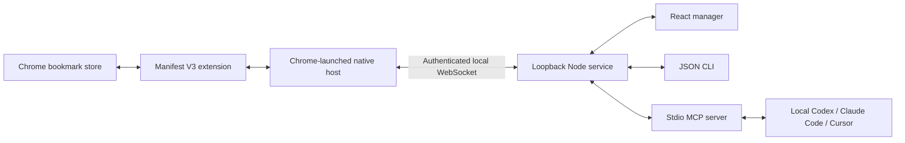

# Architecture

Chrome initiates `connectNative`; its native host then connects to the separately started service. There is one native process per extension port. The service multiplexes connected profile sessions. The manager, CLI and MCP select a sole profile automatically; with multiple profiles they require a choice. CLI/MCP resolve profile labels or stable IDs through authenticated status in `src/client.ts` and pass the current session ID to the unchanged HTTP RPC envelope. Profile discovery does not cache or guess a connection; unmatched and ambiguous selectors fail before bookmark dispatch. An explicit session ID bypasses discovery. Previews remain session-bound, preventing a commit from switching profiles after a reconnection. A duplicated profile UUID is rejected to avoid ambiguous routing.

The extension stores a randomly generated profile UUID locally, without reading Chrome profile directories or requesting identity permissions. The label is entered in extension settings. Each connection gets a fresh service session ID, invalidating outstanding previews on disconnect.

The shared operation/validation layer lives in `src/protocol.ts` and `src/operations.ts` and is bundled into the extension. Agent/UI requests enter `src/server.ts`; actual bookmark changes execute only through `chrome.bookmarks`. Incoming payloads use strict Zod schemas at the service and extension boundaries. Titles and URLs are data, never agent instructions or HTML.

The service serializes requests per session. Preview reads the entire tree, validates every action, records a SHA-256 digest and shows the affected nodes. Commit consumes the preview, rereads and compares the tree, saves and flushes the complete pre-change snapshot, then dispatches the plan. The extension checks the digest again and validates the plan immediately before execution. Mutations target existing parent IDs; a batch cannot reference the IDs of newly created folders. Each node can be modified once per plan to avoid ambiguous dependencies.

`src/scope.ts` resolves an optional union of existing folder IDs, with descendants included by default. The service bounds all scoped reads and previews before responding or dispatching mutations. Read snapshots prune excluded children and preserve inherited managed protections. Search, duplicate detection, rediscovery and export use only the selected nodes; search filtering precedes pagination. Selected scope roots are protected, both write targets and destinations are checked, and folder moves/deletions cannot affect excluded descendants. Preview stores scope; commit cannot replace it, and validates it again after the full-tree digest check. Full backups retain the original entire tree plus the scope. The scope checks run in the service, allowing an already-loaded compatible extension to continue working after a service restart. The current scoped implementation still obtains the full native tree internally, so scope reduces returned data and allowed actions but does not remove the native full-tree size limit.

The UI's scope selection applies to its own requests. CLI flags and MCP parameters specify scope per operation; manager selection does not silently change agent requests. Authentication still grants access to the enabled profile, so folder scope is an operation boundary rather than a separate authorization credential. The manager keeps the full folder catalog for choosing a scope, and a page reload resets its selection to the entire library.

A full-tree digest conservatively invalidates a preview even for unrelated Chrome/Sync changes. There remains a race with external changes during the batch because Chrome supplies no transaction or compare-and-swap operation. Validation and backups mitigate mistakes but cannot guarantee atomic rollback.

Transport failures never replay writes. The service terminates a timed-out bridge connection and clears its session; extension and native host reconnect with a fresh session. Partial failures contain completed operations. Backups are named by preview UUID and include original tree, profile/session metadata and planned actions; the API supplies the path even if execution fails. A backup alone is not evidence that a write completed.

Protocol limits: HTTP request 128 KiB; plan 100 actions; queue 100 per session; 100 active previews; preview lifetime five minutes; operation timeout 20 seconds. Extension-to-host frames can be up to 64 MiB. Host-to-extension commands obey Chrome's 1 MiB limit. Extremely large libraries should be read as subtrees; full-tree export/preview currently requires the tree to fit within 64 MiB.

Windows registration compiles a small C# launcher with the existing .NET Framework compiler. The launcher forwards binary stdin/stdout with a flush per block, uses no shell command parsing, and runs Node without a console window. Setup is per-user and limits native origins to the stable extension ID. The host is `com.bookmark_agent.next`; the default companion-service port is `32180`.

The manager establishes its browser session with a same-origin POST and a custom header; the server issues a random process-local HttpOnly, SameSite=Strict cookie, scoped to the API path. Cookie-authenticated requests must include same-origin Fetch Metadata and the custom header; POST additionally requires the exact loopback Origin. Exact Host checks and absent external CORS prevent other websites and other loopback ports from using this flow. Agent bearer credentials and the separate native bridge credential remain unchanged. Anyone using this computer can open the manager; local software is trusted and this is not an OS-user authentication boundary.

Official platform references checked 2026-10-10:

- [Fetch Metadata](https://developer.mozilla.org/en-US/docs/Web/HTTP/Guides/Fetch_metadata) and [Set-Cookie](https://developer.mozilla.org/en-US/docs/Web/HTTP/Reference/Headers/Set-Cookie): browser origin metadata and session cookie attributes.

- [Chrome bookmarks API](https://developer.chrome.com/docs/extensions/reference/api/bookmarks): permissions, protected roots, operations and usage timestamps.
- [Native messaging](https://developer.chrome.com/docs/extensions/develop/concepts/native-messaging): host registration, caller origin, binary frames and size limits.
- [Service worker lifecycle](https://developer.chrome.com/docs/extensions/develop/concepts/service-workers/lifecycle): native-port lifetime and reconnect events.
- [Official MCP server guide](https://modelcontextprotocol.io/docs/develop/build-server): tool definitions and stdio transport.
